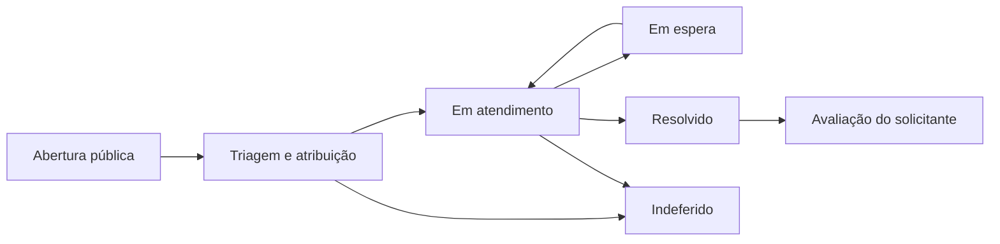
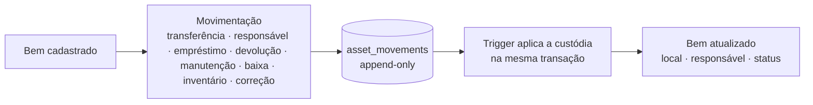
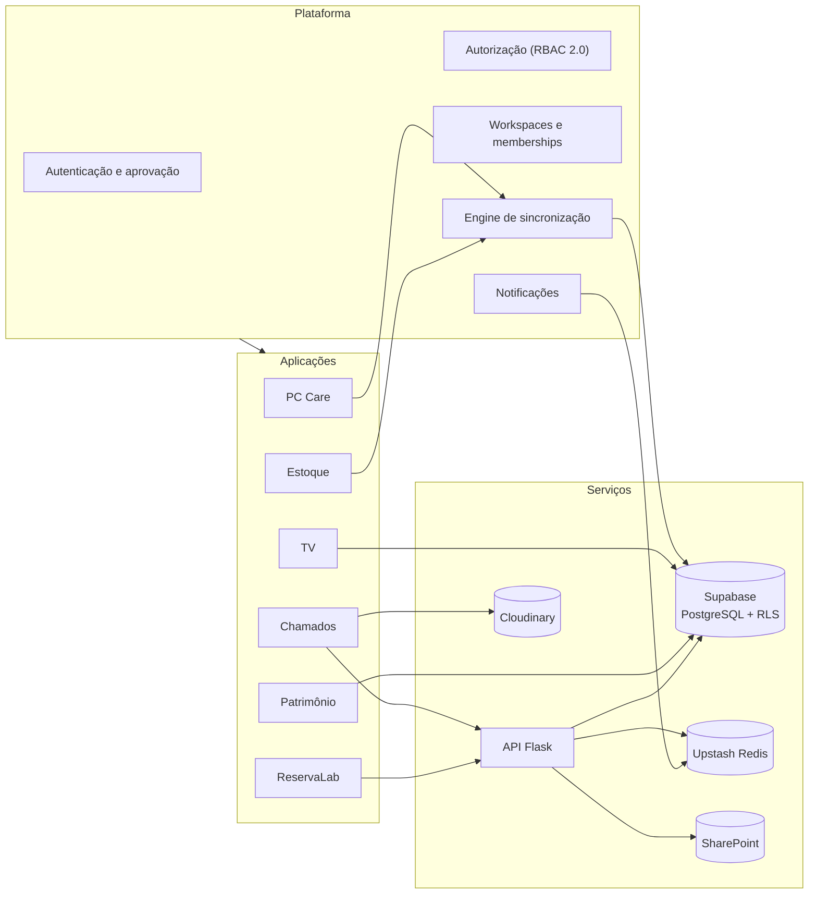
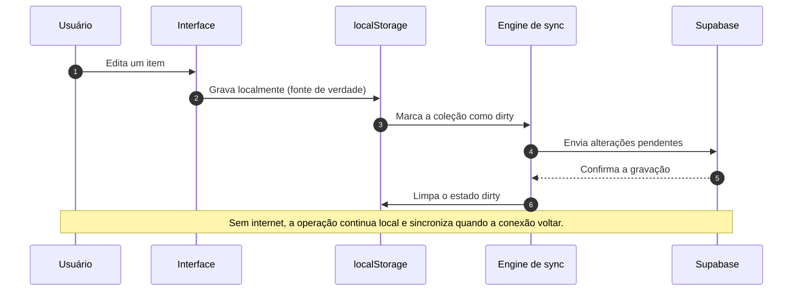
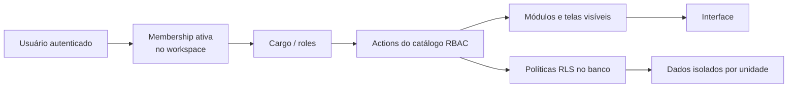

<p align="center">
  
</p>

<h1 align="center">LabHub</h1>

<p align="center">
  <strong>Plataforma modular para a operação dos laboratórios de informática</strong>
</p>

<p align="center">
  <a href="https://lab-hub-pi.vercel.app">
    
  </a>
  
  
  
</p>

---

<p align="center">
  Um único PWA para inventário de computadores, estoque, reservas de laboratório, patrimônio, chamados de suporte e murais digitais em campi universitários.
</p>

## Índice

- [Sobre o LabHub](#sobre-o-labhub)
- [Demonstração](#demonstração)
- [Aplicações](#aplicações)
- [Plataforma](#plataforma)
- [Arquitetura](#arquitetura)
- [Stack](#stack)
- [Segurança e isolamento](#segurança-e-isolamento)
- [Qualidade e automação](#qualidade-e-automação)
- [Documentação](#documentação)
- [Desenvolvimento](#desenvolvimento)
- [Licença](#licença)

## Sobre o LabHub

Equipes de TI de laboratórios universitários convivem com ferramentas fragmentadas: planilhas para reservas, checklists em papel, sistemas separados para estoque e para chamados. O resultado é dado espalhado, coordenação manual e pouca visibilidade da operação.

O LabHub reúne toda essa operação em uma plataforma única, modular e **offline-first**, pensada para o dia a dia de campi com múltiplas unidades.

**Princípios da plataforma**

- **Modular** — cada aplicação tem rotas, serviços e tema próprios, carregados sob demanda.
- **Offline-first** — o `localStorage` é a fonte de verdade; o Supabase sincroniza em segundo plano.
- **Isolado por workspace** — todo dado é escopado por campus/unidade, com RLS e RBAC.
- **Progressivo** — instalável como PWA e utilizável em celular, tablet, desktop e TVs.
- **Multi-tenant** — uma pessoa pode participar de vários workspaces com cargos diferentes.

## Demonstração

**1. Chamados em uso** — abertura pública, acompanhamento e painel de TI.

<p align="center">
  
</p>

**2. Deixa que a gente resolve** — a plataforma cuidando da operação dos laboratórios.

<p align="center">
  
</p>

## Aplicações

| Aplicação | Rota | O que faz |
|-----------|------|-----------|
| **Chamados** | `/chamados` · `/chamados/meus` · `/chamados-publico` | Abertura pública e gestão de chamados técnicos, com SLA, push e avaliação |
| **PC Care** | `/pc-care` | Inventário, limpeza e manutenção preventiva de computadores |
| **Estoque** | `/stock` | Materiais, movimentações, kits e inventário cíclico |
| **ReservaLab** | `/reservalab` | Reservas de laboratório e tablets, com dashboard e lembretes |
| **TV** | `/tv` · `/tv/display` | Murais digitais: eventos, vídeos, música, avisos e galerias |
| **Patrimônio** | `/patrimonio` | Acervo institucional de TI com custódia e histórico de movimentações |

Cada aplicação é habilitada por workspace e respeita o cargo do usuário. A documentação detalhada de cada uma está em [`docs/apps/`](docs/apps/README.md).

### Chamados

> Chamados técnicos e ordens de serviço para os laboratórios de informática.  
> **Cor:** âmbar · **Código:** `src/apps/chamados`, `src/apps/chamados-publico`, `src/apps/chamados-dashboard`

O Chamados conecta professores que relatam problemas aos técnicos que os resolvem, acompanhando todo o ciclo de vida da solicitação e monitorando prazos de SLA.

- **Abertura pública** — formulário por QR Code ou link, sem exigir login do professor; foto opcional via Cloudinary (até 600 KB).
- **Painel de TI** — fila com filtros por status, prioridade, campus e responsável, atribuição, comentários e operações em lote.
- **SLA** — prazos de resposta e resolução por prioridade, com estados de **em espera** e **indeferimento** sempre motivados.
- **Meus Chamados** — área autenticada do solicitante, com os chamados que ele abriu.
- **Acompanhamento e avaliação** — consulta pública pelo link, atualizações em tempo real e avaliação de 1 a 5 estrelas.
- **Notificações push** — avisos de novo chamado e de mudança de status.
- **Relatórios** — exportação em CSV, XLSX e PDF, com agregação por técnico.

Fluxo de atendimento:



**Dados:** API Flask (`/api/chamados*`), Supabase e Supabase Realtime. As fotos ficam no Cloudinary. A aplicação não importa código de outras aplicações.

[Documentação do Chamados →](docs/apps/chamados/README.md)

### PC Care

> Inventário, limpeza e manutenção de computadores.  
> **Cor:** violeta · **Rota:** `/pc-care` · **Código:** `src/apps/pcare`

O PC Care acompanha o ciclo de vida completo das máquinas dos laboratórios, do inventário à manutenção preventiva.

- **Inventário de PCs** — especificações de hardware e software, configuração, fotos e localização por máquina.
- **Controle de peças** — vínculo entre peças e computadores, com histórico de substituições.
- **Checklists** — templates configuráveis e registro de execução de limpeza e restauração.
- **Manutenção preventiva** — agendamento, calendário e acompanhamento de conclusão.
- **QR Codes** — geração para impressão e leitura pela câmera.
- **Relatórios e operações em lote** — exportação em CSV, XLSX e PDF, com gráficos.
- **Consolidado de estoque por laboratório**.

**Dados:** `localStorage` com sincronização para o Supabase, no schema `pcare`.

[Documentação do PC Care →](docs/apps/pc-care/README.md)

### Estoque

> Materiais e suprimentos dos laboratórios de informática.  
> **Cor:** esmeralda · **Rota:** `/stock` (alias `/general-stock`) · **Código:** `src/apps/stock`

O Estoque controla níveis de inventário, movimentações, kits e contagens cíclicas de cabos, adaptadores, periféricos, material de escritório e peças.

- **Seções de material** com subcategorias.
- **Movimentações** — entrada, saída, empréstimo, devolução e transferência, com histórico por item.
- **Kits** — agrupamento de itens com checklist de conferência e status de completude.
- **Inventário cíclico** — contagens periódicas com comparação contra o sistema e destaque de divergências.
- **Entrada e saída rápida** — fluxo simplificado de movimentação.
- **Manutenção preventiva** — agendamento para equipamentos.
- **QR Codes** — geração para impressão, incluindo etiquetas, e leitura pela câmera.
- **Integração com o Patrimônio** — equipamentos compartilham o Registro Global de Ativos.

**Dados:** `localStorage` com sincronização para o Supabase, no schema `stock`.

[Documentação do Estoque →](docs/apps/stock/README.md)

### ReservaLab

> Gestão de reservas de laboratórios e de tablets.  
> **Cor:** índigo · **Rota:** `/reservalab` · **Código:** `src/apps/reservalab`

O ReservaLab reúne a ocupação dos laboratórios e o empréstimo de tablets em um calendário único. As reservas de laboratório vêm de uma planilha Excel no SharePoint (somente leitura); as de tablet são gerenciadas no Supabase.

- **Reservas de laboratório** — visualização por dia e por semana.
- **Reservas de tablet** — CRUD completo, com modal de cadastro e erros em linha.
- **Dashboard de ocupação** — totais, média diária e taxa de ocupação.
- **Notificações push** — lembretes configuráveis antes do início da reserva (padrão de 30 minutos).
- **Múltiplos laboratórios** — quantidade configurável por campus (`lab_count`).
- **Limpeza automática** — remoção de reservas de tablet canceladas há mais de 30 dias.
- **Evento na TV** — a partir de uma reserva, publique um evento na TV do campus.

**Dados:** API Flask (leitura do SharePoint), Upstash Redis (cache e push) e Supabase (`tablet_reservations`). O ReservaLab hospeda o backend Flask principal do projeto, responsável por todas as rotas `/api/*`.

[Documentação do ReservaLab →](docs/apps/reservalab/README.md)

### TV

> Canal corporativo e murais digitais dos laboratórios.  
> **Cor:** vermelho · **Rota:** `/tv` (admin) e `/tv/display` (tela cheia) · **Código:** `src/apps/tv`

A TV opera em dois modos: **admin**, para gestão de conteúdo, e **display**, para reprodução em tela cheia nos murais dos laboratórios.

- **Eventos** — por campus, direcionados a uma TV específica ou a todas as TVs da unidade.
- **Playlists de vídeo** — integração com o YouTube e busca de metadados.
- **Música** — filas de reprodução em segundo plano e pedidos de música.
- **Avisos** — mensagens em rolagem, incluindo alertas urgentes por severidade.
- **Galerias de fotos** — carrosséis de imagens.
- **Gestão de dispositivos** — códigos de ativação para as TVs.
- **Fonte externa de eventos** — planilha do SharePoint/OneDrive, com validação de URL e cache por workspace.

**Dados:** acesso direto ao Supabase, sem sincronização local, nas tabelas `tv_*`; metadados de vídeo e fonte externa passam pela API Flask (`/api/tv/*`).

[Documentação da TV →](docs/apps/tv/README.md)

### Patrimônio

> Acervo institucional de bens de TI, com custódia e histórico auditável.  
> **Rota:** `/patrimonio` · **Código:** `src/apps/patrimonio`, `src/core/patrimonio`

O Patrimônio registra os bens de TI da unidade, quem é responsável por cada um e onde estão. A custódia só muda por movimentação registrada — nunca por edição direta do ativo.

- **Acervo de bens** — busca, filtros por status, condição e local, com paginação.
- **Cadastro e edição** — nome, tipo de equipamento, tombo, número de série, fabricante, modelo, condição física e notas.
- **Locais e responsáveis** — diretórios por unidade; o responsável é institucional e não exige conta no LabHub.
- **Movimentações** — transferência, troca de responsável, empréstimo, devolução, manutenção, baixa, inventário e correção.
- **Histórico append-only** — cada movimento é imutável e fica vinculado ao bem.
- **Custódia atômica** — local, responsável e status mudam apenas via `asset_movements`; a trigger do banco aplica o efeito na mesma transação.
- **Status e condição independentes** — “danificado” é condição física, não um status de custódia.



**Dados:** leitura e escrita diretas no Supabase, sempre frescas e escopadas por workspace via RLS. O módulo fica **fora** do motor de sincronização local-first.

[Camada de dados do Patrimônio →](docs/patrimonio/data-layer.md)

## Plataforma

Recursos compartilhados por todas as aplicações:

| Recurso | O que oferece |
|---------|---------------|
| **Dashboard** | Métricas e atividade da plataforma |
| **Administração** | Usuários, workspaces, permissões, regras de notificação, backups e solicitações |
| **Liderança e coordenação** | Áreas próprias para líderes de equipe e coordenação |
| **Onboarding** | Tour guiado com destaque individual dos módulos permitidos |
| **Notificações** | Central de notificações e Web Push (VAPID) |
| **Busca** | Paleta de comandos para navegação rápida |
| **Temas** | Claro, escuro e dim, aplicados também aos sub-apps |
| **Novidades** | Changelog integrado à plataforma |

## Arquitetura

O LabHub é um PWA React carregado sob demanda por aplicação. A plataforma fornece autenticação, autorização, workspaces, sincronização e notificações; cada aplicação consome apenas os serviços de que precisa.



### Padrões de fluxo de dados

| Padrão | Aplicações | Caminho |
|--------|------------|---------|
| **Local-first com sincronização** | PC Care, Estoque | Interface → serviço → `localStorage` → engine de sync → Supabase |
| **Mediado pela API** | Chamados, ReservaLab, TV | Interface → API Flask → Supabase / SharePoint / YouTube |
| **Acesso remoto direto** | TV, tablets do ReservaLab, Patrimônio | Interface → cliente Supabase → RLS |
| **Fonte externa** | ReservaLab, TV | Interface → API Flask → planilha no SharePoint → cache (Redis/arquivo) |

### Sincronização offline-first



### Decisões de projeto

- **`localStorage` como fonte de verdade** — API simples, acesso síncrono e volume suficiente para o escopo.
- **Flask para Chamados e integrações** — permite validações no servidor, push e acesso a fontes externas.
- **RLS no Patrimônio e nos dados compartilhados** — isolamento por workspace garantido pelo banco.
- **Carregamento sob demanda** — cada aplicação é um chunk separado, carregado quando necessário.

## Stack

<table>
  <tr>
    <td><strong>Frontend</strong></td>
    <td>React 19 · TypeScript · Vite · Tailwind CSS v4 · Radix UI</td>
  </tr>
  <tr>
    <td><strong>Dados</strong></td>
    <td>localStorage (offline-first) · Supabase PostgreSQL · IndexedDB</td>
  </tr>
  <tr>
    <td><strong>Backend</strong></td>
    <td>Flask (Python) · Vercel Serverless · Upstash Redis</td>
  </tr>
  <tr>
    <td><strong>Realtime</strong></td>
    <td>Supabase Realtime (WebSocket) · Web Push (VAPID)</td>
  </tr>
  <tr>
    <td><strong>Qualidade</strong></td>
    <td>Vitest · Testing Library · oxlint · GitHub Actions</td>
  </tr>
  <tr>
    <td><strong>Deploy</strong></td>
    <td>Vercel (automático em push para <code>main</code>)</td>
  </tr>
</table>

## Segurança e isolamento

O acesso é resolvido em camadas: a autenticação identifica a pessoa, a membership define a unidade ativa, o cargo determina as Actions permitidas e o banco aplica RLS sobre cada workspace.



- **RBAC 2.0** — permissões declaradas como Actions e agrupadas por cargo.
- **RLS** — o banco é a última linha de defesa; nenhuma permissão é reimplementada no cliente.
- **Workspaces** — todo dado é escopado por unidade, com módulos habilitados por campus.
- **Aprovação de acesso** — novos usuários passam pelo fluxo de aprovação antes de entrar.
- **Sessão e JWT** — operações sensíveis usam o token da sessão, nunca `service_role`.
- **Sem cópia entre unidades** — consultas e escritas exigem workspace ativo (fail-closed).

Detalhes em [Autenticação](docs/platform/security/authentication.md), [Autorização](docs/platform/security/authorization.md) e [RBAC 2.0](docs/platform/rbac/README.md).

## Qualidade e automação

| Comando | O que faz |
|---------|-----------|
| `npm run dev` | Inicia o frontend em modo de desenvolvimento |
| `npm run dev:api` | Inicia a API Flask localmente |
| `npm run test:run` | Executa a suíte de testes uma vez |
| `npm run test:coverage` | Gera cobertura de testes |
| `npm run lint` | Analisa o código com oxlint |
| `npm run build` | Checagem de tipos e build de produção |
| `npm run preview` | Pré-visualiza o build de produção |
| `npm run analyze` | Analisa o tamanho do bundle |
| `npm run release` | Gera versão e changelog com standard-version |

O CI roda em GitHub Actions a cada push e pull request para `main`.

## Documentação

A documentação completa fica em [`docs/`](docs/README.md):

| Seção | Conteúdo |
|-------|----------|
| [Plataforma](docs/platform/README.md) | Arquitetura, conceitos, segurança, RBAC e decisões |
| [Aplicações](docs/apps/README.md) | Documentação por aplicação |
| [Patrimônio](docs/patrimonio/data-layer.md) | Camada de dados e auditoria do acervo |
| [Guias](docs/guides/README.md) | Setup, desenvolvimento, testes e migrações |
| [Referência](docs/reference/README.md) | API, banco de dados, eventos, tipos e configuração |
| [Auditorias](docs/audits/README.md) | Análises e validações datadas |
| [Operações](docs/operations/deployment.md) | Deploy, monitoramento e recuperação |

## Desenvolvimento

O código-fonte é privado e restrito à equipe do projeto. O desenvolvimento acontece diretamente no repositório interno.

**Pré-requisitos:** Node.js 20.19+ (ou 22.12+), npm e Python 3.10+ para a API Flask.

```bash
# Instalar dependências
npm install

# Configurar variáveis de ambiente
# Copie .env.example para .env e preencha as credenciais do Supabase
Copy-Item .env.example .env

# Iniciar o frontend
npm run dev

# Em outro terminal, iniciar a API Flask
npm run dev:api
```

Consulte o [Guia de setup](docs/guides/setup.md) para a configuração completa do ambiente e das variáveis.

## Licença

Proprietária — todos os direitos reservados. Consulte [LICENSE](LICENSE).

---

<p align="center">
  <sub>Desenvolvido com dedicação para laboratórios de informática universitários.</sub>
</p>
