# Chamados — Fluxos

> Passo a passo dos fluxos de uso do Chamados.

## Ciclo de vida do chamado

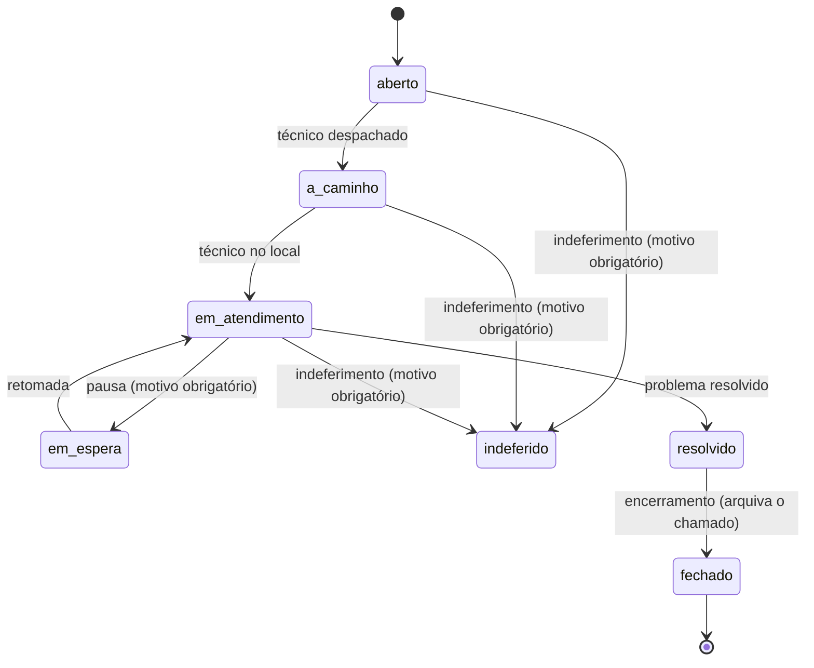

Um chamado também pode ser arquivado a qualquer momento, o que o retira da visão
ativa sem alterar o status.

Dois estados **não** fazem parte da linha "resolvido → fechado":

- **`em_espera`** — pausa do atendimento: sai da fila ativa, permanece no
  histórico e é **retomável** (volta para `em_atendimento`).
- **`indeferido`** — estado **final** próprio: sai da fila ativa, **não** é
  arquivado, **não** conta como resolvido e **não** é retomável.

Os dois exigem um **motivo predefinido**, validado no servidor.

## Fluxo 1 — Abertura de chamado (professor)

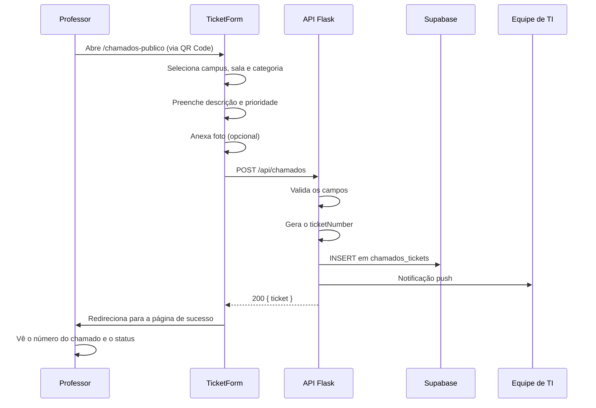

## Fluxo 2 — Atendimento do chamado (técnico)

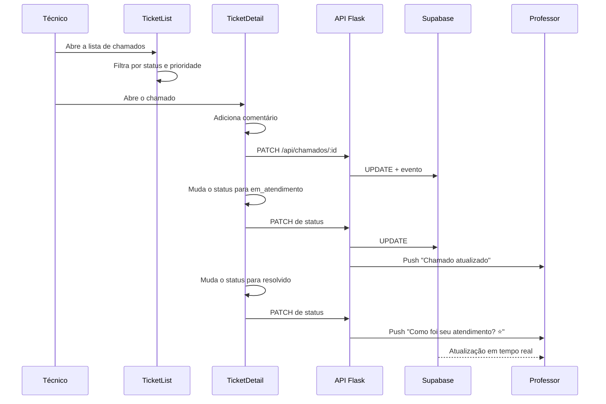

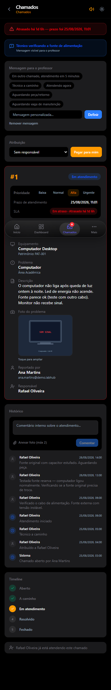

O detalhe do chamado concentra a timeline de eventos, as fotos anexadas, o controle de SLA e o botão de avanço de status.

## Fluxo 3 — Avaliação do atendimento (professor)

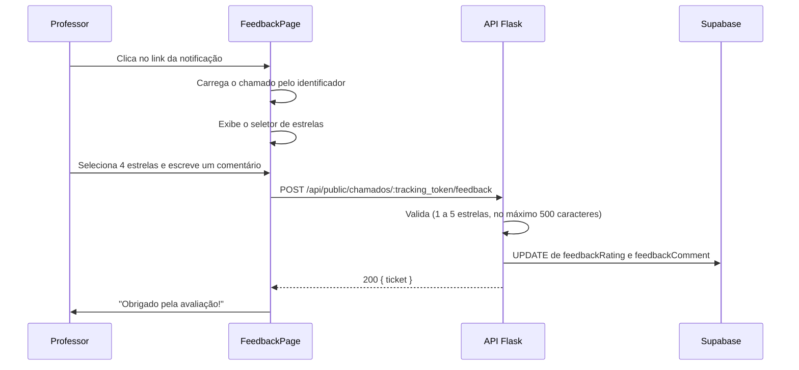

Regras da avaliação:

- Disponível apenas com status `resolvido` ou `fechado` e sem avaliação prévia
- Um chamado recebe no máximo uma avaliação, sem edição posterior; a gravação é
  atômica, então dois envios simultâneos não geram avaliação dupla
- A notificação de chamado resolvido traz link direto para o formulário

### Caminho público (link de acompanhamento)

- Sem login: o identificador da URL é o **token de acompanhamento**, que prova
  ser o dono do link. O chamado é resolvido a partir do token, nunca de um id
  enviado pelo cliente
- `POST /api/public/chamados/:tracking_token/feedback`

### Caminho autenticado (Meus Chamados)

Para quem está logado, avaliar não depende do token guardado no navegador
original (útil no cenário PC → celular):

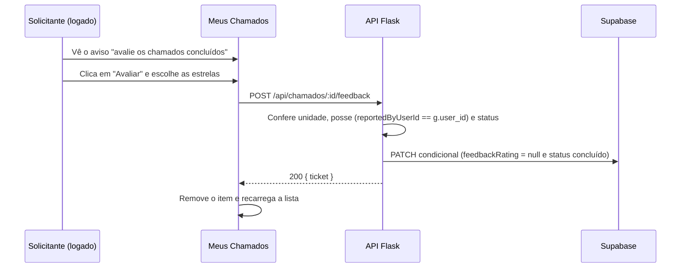

- O aviso é dispensável e tem limite de reapresentação; a chave local é escopada
  por usuário e chamado, então trocar de conta não mistura lembretes
- Só remove o item após o `200`; em falha mantém o formulário aberto para
  tentar de novo, e trata `409` como "já avaliado"
- `POST /api/chamados/:id/feedback`

## Fluxo 4 — Aprovação de usuário (admin)

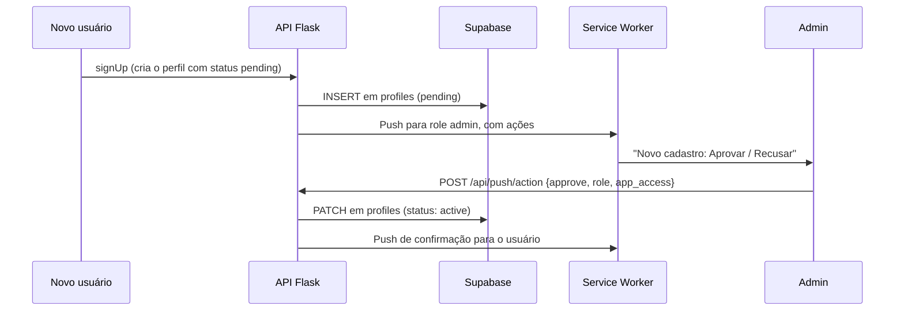

**Limitação do Web Push:** os botões de ação aparecem apenas no Chrome para Android e no desktop. No iOS/Safari a notificação apenas abre a URL definida, e o admin chega ao modal de aprovação pelo deep link `/admin/users?pending=<id>`.

## Fluxo 5 — Operações em lote (técnico)

1. Selecionar vários chamados pelas caixas de seleção
2. A barra de ações em lote apresenta as opções:
   - Arquivar selecionados
   - Atribuir a um técnico
   - Alterar prioridade
   - Alterar status
3. Confirmar no diálogo
4. Todos os chamados selecionados são atualizados
5. A lista é recarregada

## Fluxo 6 — Em espera e Indeferimento (técnico e solicitante)

Fluxo operacional novo (issue #367): pausar o atendimento sem resolvê-lo e
recusar formalmente uma solicitação, sempre com motivo predefinido. Detalhe
visual em [`docs/chamados-demo/screenshots/`](../../chamados-demo/screenshots/README.md) (capturas 12–19).

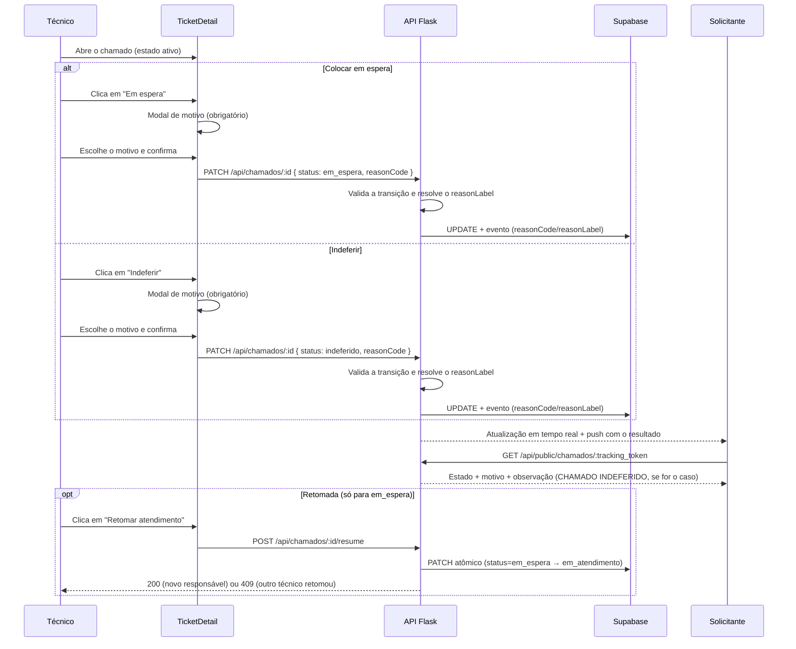

### Em espera

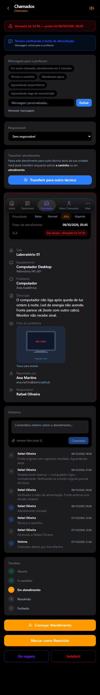

Regras:

- **Motivo obrigatório** de um catálogo predefinido (retorno do solicitante,
  equipamento/peça, terceiro/fornecedor, autorização, agendamento ou outro).
  O cliente envia só o `reasonCode`; o rótulo é resolvido no servidor.
- **Somente a partir de um estado ativo** da fila (`aberto`, `a_caminho` ou
  `em_atendimento`) — um chamado resolvido/fechado não pode ser pausado.
- **Única saída**: a retomada (`→ em_atendimento`). A retomada é atômica e pode
  ser feita por **qualquer técnico** do workspace (não fica travada pela
  disponibilidade do responsável anterior); em corrida, um vence e o outro
  recebe `409` sem efeitos.

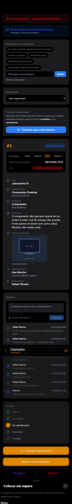

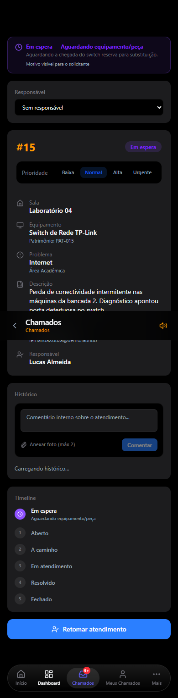

### Indeferimento

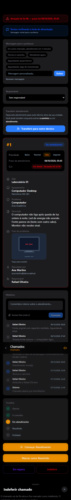

Regras:

- **Motivo obrigatório** de um catálogo predefinido (fora do escopo,
  duplicado, não é requisição de TI, recurso não pertence à instituição,
  outro setor, informações insuficientes ou outro).
- **Somente a partir de um estado ativo** da fila.
- **Estado final**: nenhuma transição de saída (não é retomado, reaberto nem
  assumido). Diferente de **resolvido**, o solicitante o vê como
  **CHAMADO INDEFERIDO** com o motivo — nunca como atendimento concluído.

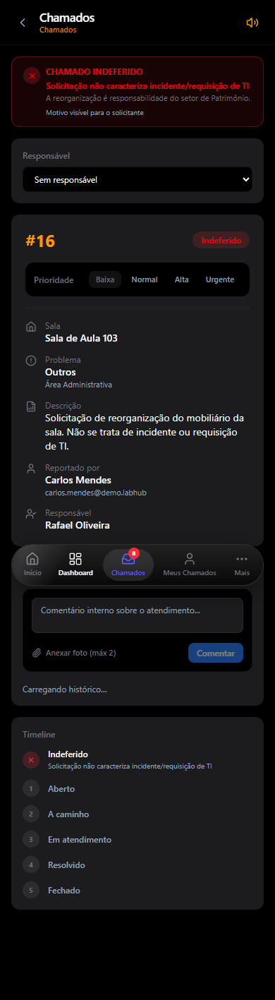

### Acompanhamento pelo solicitante

O link público de acompanhamento (token) mostra o estado e o motivo, sem login:

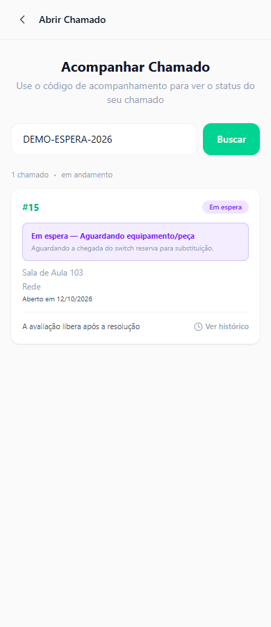

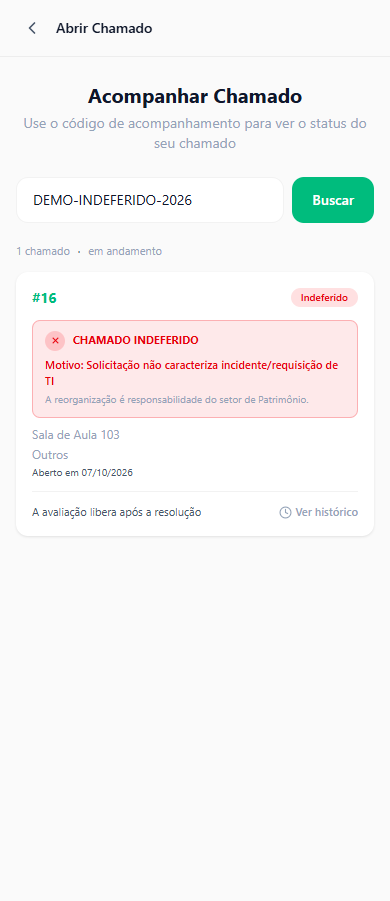

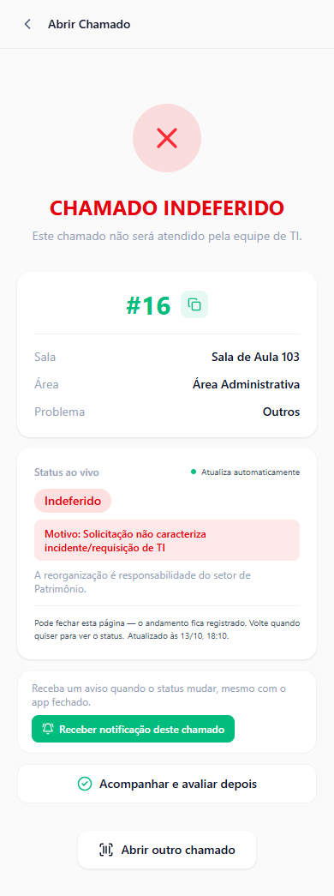

## Relacionados

- [Visão geral](README.md)
- [Arquitetura](architecture.md)
- [Referência](reference.md)
