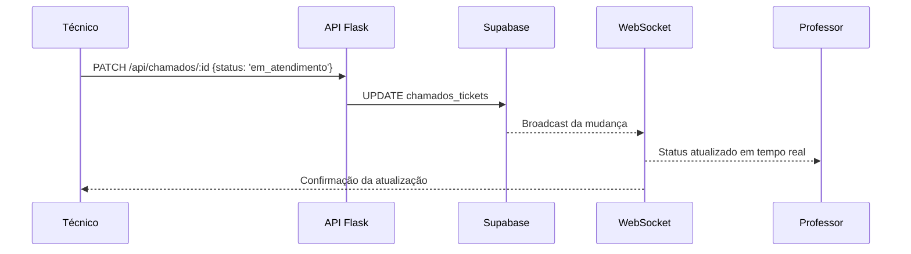

# Realtime

> Como o LabHub entrega atualizações instantâneas?

## O que é

O LabHub usa o Supabase Realtime (conexões WebSocket) para propagar mudanças de dados aos clientes conectados sem polling. O uso principal é no Chamados, para atualização instantânea de status.

## Como funciona

### Padrão de assinatura

```typescript
useRealtimeSubscription<TableType>(
  'table_name',           // tabela do Supabase
  '*',                    // tipo de evento: INSERT, UPDATE, DELETE ou *
  (payload) => { ... },   // callback com os dados novos/antigos
  {
    channelName: 'unique:channel:name',
    enabled: boolean,     // condição para assinar
  }
)
```

### Fluxo de realtime no Chamados



### Canal de broadcast

Para comunicação entre abas (por exemplo, o mesmo usuário em várias abas):

```typescript
useRealtimeBroadcast(channelName, {
  onBroadcast: (event) => { ... }
})

// Envio
broadcast({ event: 'ticket_updated', payload: data })
```

### Presença

Permite saber quais usuários estão vendo um chamado:

```typescript
useRealtimePresence(channelName, {
  user: { id, name, avatar }
})
```

## Estado da conexão e fallback

O hook `useRealtimeSubscription` expõe o estado do canal (`SUBSCRIBED`, `CHANNEL_ERROR`, `TIMED_OUT` e `CLOSED`) por `onStatus`. A fila de Chamados usa essa informação para manter o WebSocket como canal primário.

- Com o canal `SUBSCRIBED`, a fila não executa polling periódico.
- Se o canal cair, a fila sincroniza imediatamente e ativa um fallback de 30 segundos enquanto a aba estiver visível.
- Ao voltar para a aba, recuperar a rede ou restabelecer o Realtime, a fila sincroniza novamente para recuperar eventos perdidos.
- O fallback é pausado enquanto a aba está oculta; não tenta competir com as limitações de execução em segundo plano do navegador.
- O fechamento automático da issue #472 é uma verificação sob demanda na abertura/atualização, separada do fallback de sincronização.

## Push não depende do polling da tela

Notificações Web Push são enviadas pelo backend e tratadas pelo Service Worker (`src/sw.ts`). A inscrição ativa no navegador não comprova, sozinha, que a notificação foi entregue/exibida pelo sistema operacional. A validação ponta a ponta exige navegador/dispositivo real, permissão concedida, subscription válida, chaves VAPID configuradas e teste com a aba em segundo plano. O polling da fila não é mecanismo de entrega de Push.

## Convenção de nomes de canal

```text
chamados:public:{ticketId}        — atualizações de um chamado específico
chamados:workspace:{wsId}         — atualizações de todos os chamados do workspace
presence:{context}                — rastreio de presença
```

## Considerações de desempenho

- Cada assinatura cria uma conexão WebSocket
- Os canais são escopados a tabelas e filtros específicos
- As assinaturas são removidas automaticamente quando o componente é desmontado
- A flag `enabled` evita conexões desnecessárias

## Relacionados

- [Sincronização](../concepts/synchronization.md)
- [Arquitetura do sistema](system.md)
- [Referência de eventos](../../reference/events.md)
